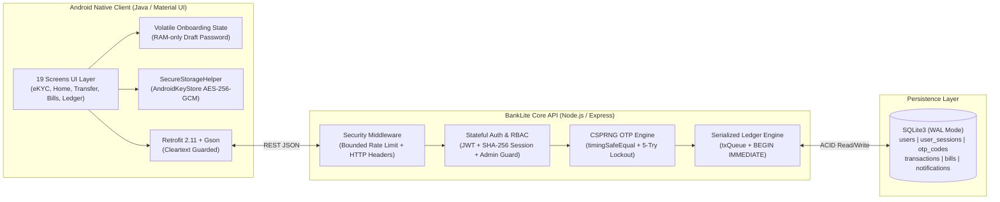
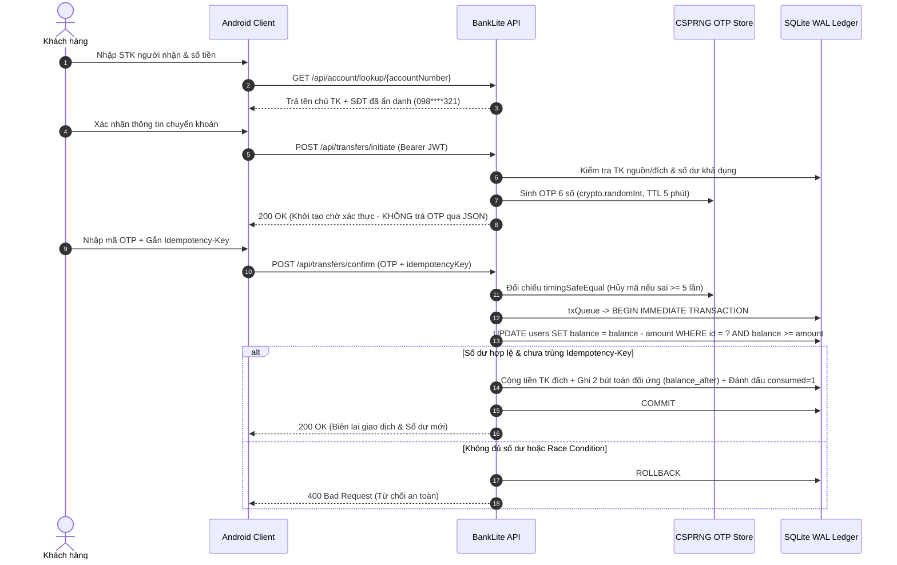

<div align="center">

# 🏦 TCB Digital Banking — Hệ Thống Ngân Hàng Số & Sổ Cái Giao Dịch Tài Chính
### Full-Stack Mobile Banking Simulation (Android Native Java + Node.js/SQLite WAL Core Ledger)

[](https://github.com/Kizakawa/tcb-digital-banking-mobile/actions/workflows/ci.yml)
-003B57?logo=sqlite&logoColor=white)

-3DDC84?logo=android&logoColor=white)


*Hệ thống ngân hàng số và sổ cái tài chính thiết kế theo tiêu chuẩn toàn vẹn giao dịch ACID, chống chi tiêu kép (Anti-Double-Spending), đối soát thu/chi ròng theo kỳ và bảo mật đa tầng OWASP API Top 10 / MASVS.*

[🎯 Tổng quan Nghiệp vụ](#tổng-quan-dự-án-executive-summary) •
[💼 Điểm nhấn CSDL, BA & Triển khai](#-điểm-nhấn-năng-lực-thiết-kế-csdl-sql--phân-tích-nghiệp-vụ-ba--triển-khai) •
[🏗️ Kiến trúc Hệ thống](#kiến-trúc-hệ-thống-system-architecture) •
[🧪 Kiểm thử Tự động (9/9)](#kiểm-thử-bảo-mật--tích-hợp-tự-động-automated-qa) •
[🚀 Hướng dẫn Cài đặt](#hướng-dẫn-cài-đặt--chạy-dự-án-quickstart)

</div>

---

## Tổng quan dự án (Executive Summary)

**TCB Digital Banking** là dự án mô phỏng toàn diện quy trình nghiệp vụ và kiến trúc kỹ thuật của một ứng dụng ngân hàng bán lẻ hiện đại (lấy cảm hứng từ trải nghiệm số của Techcombank Mobile). Thay vì chỉ dừng ở mức giao diện minh họa, dự án tập trung giải quyết các bài toán kỹ thuật cốt lõi trong lĩnh vực **FinTech & Phần mềm Quản trị Tài chính**:

- **Toàn vẹn sổ cái & Chống Race Condition (Zero Double-Spending):** Điều phối ghi tuần tự kết hợp khóa giao dịch tức thời `BEGIN IMMEDIATE TRANSACTION` trên **SQLite WAL**, kiểm tra số dư nguyên tử ngay trong câu lệnh `UPDATE` và chống gửi trùng giao dịch bằng khóa `idempotencyKey`.
- **Bảo mật thiết bị đầu cuối theo chuẩn OWASP MASVS:** Mã hóa toàn bộ JWT Session và thông tin định danh nhạy cảm (CCCD, SĐT) bằng khóa phần cứng **AndroidKeyStore (`AES-256-GCM`)**; giữ mật khẩu khởi tạo hoàn toàn trên RAM khả biến (`transient`); chặn lưu lượng HTTP dạng rõ toàn cục và cô lập quyền truy cập từng `Activity`.
- **Xác thực giao dịch đa bước & Phòng thủ API theo OWASP API Top 10:** Sinh mã OTP 6 chữ số bằng nguồn ngẫu nhiên mật mã học (`crypto.randomInt`), so sánh hằng thời gian (`crypto.timingSafeEqual`), tự động hủy mã OTP ngay sau **5 lần nhập sai**, quản lý phiên đăng nhập **Stateful JWT (`SHA-256`)** và thu hồi toàn bộ phiên cũ khi đặt lại mật khẩu.
- **Trải nghiệm sản phẩm khép kín (19 màn hình Android Native):** Bao phủ trọn vẹn hành trình khách hàng từ mở tài khoản trực tuyến **eKYC 8 bước** & định giá **Tài khoản Số đẹp** đến **Chuyển tiền nhanh 24/7**, **Thanh toán hóa đơn đa dịch vụ** và **Phân tích dòng tiền cá nhân**.

> Tài liệu phân tích chuyên sâu về Mô hình mối đe dọa (Threat Model) và ma trận đối chiếu OWASP được trình bày tại **[SECURITY_ARCHITECTURE.md](SECURITY_ARCHITECTURE.md)**.

---

## 💼 Điểm Nhấn Năng Lực: Thiết Kế CSDL (SQL) • Phân Tích Nghiệp Vụ (BA) • Triển Khai

| Góc Nhìn Đánh Giá | Giải Pháp Kỹ Thuật & Nghiệp Vụ Đã Triển Khai Trong Dự Án |
| :--- | :--- |
| **🗄️ Thiết Kế CSDL & Lập Trình SQL**<br>*(banklite-api/src/db.js)* | • **Lược đồ Sổ cái 6 Bảng Quan hệ (`users`, `user_sessions`, `otp_codes`, `transactions`, `bills`, `notifications`):** Đảm bảo tính nhất quán dữ liệu giữa số dư tài khoản và tổng phát sinh Nợ/Có trên sổ cái giao dịch.<br>• **Giao dịch Nguyên tử ACID & Chống Chi tiêu kép:** Mọi lệnh chuyển tiền/thanh toán hóa đơn đều chạy trong `BEGIN IMMEDIATE TRANSACTION`, sử dụng câu lệnh cập nhật có điều kiện `UPDATE users SET balance = balance - ? WHERE id = ? AND balance >= ?` và ràng buộc `UNIQUE(idempotency_key)` để loại bỏ hoàn toàn nguy cơ âm quỹ khi có nhiều truy vấn đồng thời.<br>• **Truy vấn Sổ cái Phân trang & Đối soát Thu/Chi (`GET /api/transactions/summary`):** Tổng hợp tổng thu, tổng chi và dòng tiền ròng theo kỳ/tháng bằng truy vấn SQL `SUM(CASE WHEN ...)`. |
| **📋 Phân Tích Nghiệp Vụ**<br>*(Business Analysis - BA)* | • **Chuẩn hóa Quy trình Nghiệp vụ Tài chính Đa bước:** Đặc tả đầy đủ luồng nghiệp vụ định danh điện tử **eKYC 8 bước**, quy tắc định giá phí mở **Tài khoản Số đẹp** theo bậc, quy trình chuyển khoản 2 bước (*Khởi tạo kiểm tra điều kiện $\rightarrow$ Xác nhận OTP & Hạch toán*) và quy trình gạch nợ hóa đơn điện/nước/internet.<br>• **Kiểm soát Ràng buộc Nghiệp vụ:** Tự động ẩn danh thông tin nhạy cảm khi tra cứu người nhận (`098****321`), chặn tự chuyển khoản cho chính mình, khóa mã OTP sau 5 lần nhập sai và lưu thông báo biến động số dư tức thời. |
| **🚀 Triển Khai & Kiểm Thử Tự Động**<br>*(Implementation & Automated QA)* | • **Kiểm thử Giao dịch Đồng thời & Bảo mật (`9/9 kịch bản E2E`):** Tự động giả lập tấn công gửi đồng thời các lệnh rút/chuyển tiền vượt số dư (`Promise.all`) để kiểm chứng cơ chế khóa giao dịch SQL và quy tắc nghiệp vụ.<br>• **Tích hợp CI/CD (`GitHub Actions`):** Tự động khởi chạy máy chủ CSDL, kiểm tra toàn bộ kịch bản nghiệp vụ API và biên dịch gói cài đặt Android trên mỗi lần cập nhật mã nguồn. |

---

## Kiến trúc hệ thống (System Architecture)

### 1. Sơ đồ kiến trúc tổng thể Full-Stack



### 2. Luồng giao dịch chuyển tiền 2 bước & Chống chi tiêu kép



---

## Điểm nhấn kỹ thuật & Bảo mật (Engineering Highlights)

| Khía cạnh kỹ thuật | Vấn đề thường gặp ở ứng dụng mô phỏng | Giải pháp kỹ thuật triển khai trong dự án | Mã nguồn tham chiếu |
| :--- | :--- | :--- | :--- |
| **Chống Race Condition Sổ cái** | Đọc số dư bằng `SELECT` rồi mới `UPDATE` dễ dẫn đến rút quá số dư khi bắn nhiều request song song (TOCTOU). | Hàng đợi tuần tự hóa giao dịch `runTransaction()` kết hợp `BEGIN IMMEDIATE` trên SQLite WAL và điều kiện nguyên tử `WHERE id = ? AND balance >= ?`. | [`banklite-api/src/db.js`](banklite-api/src/db.js), [`banklite-api/server.js`](banklite-api/server.js) |
| **Lưu trữ Token & PII trên Android** | Lưu JWT và CCCD dạng văn bản thuần trong `SharedPreferences` dễ bị trích xuất trên thiết bị root hoặc qua backup. | Sinh khóa bất đối xứng/đối xứng phần cứng trong `AndroidKeyStore`, mã hóa `AES/GCM/NoPadding` (256-bit, IV 12 bytes ngẫu nhiên, Tag 128-bit) và tắt `android:allowBackup="false"`. | [`SecureStorageHelper.java`](app/src/main/java/com/example/tcbstudymobile/storage/SecureStorageHelper.java), [`SessionManager.java`](app/src/main/java/com/example/tcbstudymobile/storage/SessionManager.java) |
| **An toàn mật khẩu luồng eKYC** | Lưu mật khẩu nháp xuống đĩa qua nhiều màn hình mở tài khoản. | Giữ mật khẩu nháp duy nhất trên biến `transient` trong bộ nhớ RAM và xóa trắng ngay khi hoàn tất đăng ký. | [`OpenAccountManager.java`](app/src/main/java/com/example/tcbstudymobile/openaccount/OpenAccountManager.java) |
| **Cơ chế OTP chống Brute-Force & Replay** | Sinh OTP bằng `Math.random()`, lộ OTP trong JSON response hoặc cho phép thử không giới hạn. | Sinh OTP bằng `crypto.randomInt(100000, 1000000)`, ẩn tuyệt đối khỏi HTTP response (`EXPOSE_DEMO_OTP=false`), đối chiếu hằng thời gian `crypto.timingSafeEqual`, hủy mã sau 5 lần sai hoặc ngay sau khi sử dụng. | [`banklite-api/src/security.js`](banklite-api/src/security.js) |
| **Quản lý phiên Stateful & Thu hồi phiên** | JWT Stateless không thể thu hồi khi người dùng đăng xuất hoặc bị lộ mật khẩu. | Lưu băm `SHA-256(token)` trong bảng `user_sessions`; hủy phiên tức thì khi `POST /api/auth/logout` và thu hồi **toàn bộ phiên đang hoạt động** ngay khi đặt lại mật khẩu. | [`banklite-api/server.js`](banklite-api/server.js), [`HomeActivity.java`](app/src/main/java/com/example/tcbstudymobile/home/HomeActivity.java) |
| **Kiểm soát đặc quyền & Bảo vệ PII** | Người dùng thường gọi được API cộng tiền hoặc xem trọn số điện thoại người khác qua API tra cứu STK. | Khóa API nạp quỹ sau `requireAdmin` (`x-admin-key`); che số điện thoại người nhận (`098****321`) khi tra cứu chuyển khoản. | [`banklite-api/src/security.js`](banklite-api/src/security.js), [`banklite-api/server.js`](banklite-api/server.js) |

---

## Phạm vi nghiệp vụ (End-to-End Product Scope)

Ứng dụng Android bao gồm **19 màn hình nghiệp vụ (`Activity`)** được chia thành 4 phân hệ rõ ràng:

### 1. Mở tài khoản trực tuyến eKYC & Kho số đẹp (8 bước)
- Kiểm tra trùng lặp số điện thoại theo thời gian thực (`POST /api/auth/check-exist`) và xác thực OTP mở tài khoản.
- Thu thập hồ sơ định danh cá nhân, mô phỏng quét căn cước công dân (**OCR/NFC ID Capture**) và xác thực khuôn mặt sinh trắc học (**Face Liveness Check**).
- Hệ thống chọn **Tài khoản Số đẹp** phân tầng: Số ngẫu nhiên miễn phí, Số chuẩn theo gợi ý, Số Phong thủy / Phú quý cao cấp và Tự chọn dãy số mong muốn.
- Khởi tạo mật khẩu bảo mật và tổng kết hồ sơ trước khi kích hoạt tài khoản.

### 2. Xác thực, Quản lý phiên & Khôi phục mật khẩu
- Đăng nhập bảo mật bằng SĐT & mật khẩu (`bcryptjs`), tự động đồng bộ hồ sơ tài khoản và thông báo chưa đọc.
- Luồng **Quên mật khẩu 2 bước** (`ForgotPasswordActivity` -> `ForgotOtpActivity`): yêu cầu OTP thật, đặt lại mật khẩu mới và tự động đăng xuất mọi thiết bị cũ.
- Đăng xuất đồng bộ hai chiều (xóa phiên trên máy chủ + xóa khóa mã hóa trên thiết bị).

### 3. Giao dịch Chuyển tiền 24/7 & Thanh toán Hóa đơn
- **Chuyển khoản nội bộ 2 bước (`TransferActivity`):** Tự động truy vấn tên người nhận khi nhập số tài khoản, kiểm tra hạn mức số dư, phát hành mã OTP giao dịch, xác nhận chuyển tiền kèm `idempotencyKey` và hiển thị biên lai tức thì.
- **Thanh toán hóa đơn đa dịch vụ (`BillService` -> `BillProvider` -> `BillCustomerCode` -> `BillReview`):** Hỗ trợ Điện, Nước, Internet, Viễn thông di động và Học phí; tra cứu công nợ thực tế theo mã khách hàng và thanh toán xác thực OTP.

### 4. Quản trị Tài chính Cá nhân & Sổ cái Giao dịch
- **Bảng điều khiển trang chủ (`HomeActivity`):** Hiển thị số dư thời gian thực (ẩn/hiện số dư), tổng thu/chi trong tháng (`GET /api/transactions/summary`) và huy hiệu thông báo biến động số dư.
- **Lịch sử giao dịch phân trang (`HistoryActivity`):** Lọc theo dòng tiền *Tất cả / Tiền vào / Tiền ra*, tìm kiếm theo từ khóa/mã tham chiếu và đối chiếu số dư lũy kế (`balanceAfter`) sau từng giao dịch.

---

## Kiểm thử bảo mật & Tích hợp tự động (Automated QA)

Dự án đi kèm bộ kiểm thử tích hợp & bảo mật tự động [`banklite-api/tests/security_e2e.test.js`](banklite-api/tests/security_e2e.test.js) chạy độc lập trên cơ sở dữ liệu tạm cô lập và được thực thi tự động trên **GitHub Actions CI** sau mỗi lần `push` hoặc `pull_request`:

| STT | Kịch bản kiểm thử tự động | Mục tiêu xác minh | Trạng thái |
| :---: | :--- | :--- | :---: |
| **01** | **HTTP Security Headers & Zero OTP Leak** | Phản hồi có đủ header chống sniffing/clickjacking/caching và tuyệt đối không chứa trường `otpCode`. | Pass |
| **02** | **Anti-Brute-Force OTP Lockout** | Nhập sai OTP 5 lần liên tiếp tự động hủy mã; lần thứ 6 nhập đúng mã cũ vẫn bị từ chối. | Pass |
| **03** | **Full eKYC Onboarding & Vanity Account** | Luồng đăng ký hoàn chỉnh từ kiểm tra SĐT, xác thực OTP đến cấp phát số tài khoản số đẹp. | Pass |
| **04** | **Admin Deposit RBAC Enforcement** | Chặn người dùng thường gọi API nạp tiền (`403 Forbidden`); chỉ cho phép quản trị viên hợp lệ. | Pass |
| **05** | **Recipient Lookup PII Masking** | Tra cứu số tài khoản người nhận trả đúng họ tên nhưng che thông tin số điện thoại cá nhân. | Pass |
| **06** | **Atomic 2-Step Money Transfer** | Khởi tạo chuyển khoản, xác thực OTP, trừ tiền người gửi & cộng tiền người nhận chính xác tuyệt đối. | Pass |
| **07** | **Utility Bill Lookup & OTP Settlement** | Tra cứu hóa đơn chưa thanh toán, thanh toán qua OTP và chuyển trạng thái hóa đơn sang `paid`. | Pass |
| **08** | **Paginated Ledger & Audit Snapshot** | Truy vấn sổ cái phân trang và kiểm chứng tính nhất quán của `balanceAfter` sau mọi giao dịch. | Pass |
| **09** | **Password Reset Anti-Replay & Revocation** | Chống dùng lại OTP đã tiêu thụ và thu hồi ngay lập tức toàn bộ JWT cũ sau khi đổi mật khẩu. | Pass |

---

## Cấu trúc thư mục (Monorepo Structure)

```text
tcb-digital-banking-mobile/
├── .github/workflows/
│   └── ci.yml                        # GitHub Actions CI: Backend E2E Security Suite + Android Gradle Build
├── app/                              # Ứng dụng Android Native (Java, SDK 24-36, AGP 9.2)
│   ├── src/main/
│   │   ├── AndroidManifest.xml       # Phân quyền tối thiểu, allowBackup=false, exported=false
│   │   ├── java/com/example/tcbstudymobile/
│   │   │   ├── auth/ & forgotpassword/ # Đăng nhập, Đăng ký & Khôi phục mật khẩu OTP 2 bước
│   │   │   ├── openaccount/          # Luồng eKYC 8 bước & Kho tài khoản số đẹp (RAM-only password)
│   │   │   ├── home/ & account/      # Trang chủ ngân hàng, Thống kê thu/chi & Hồ sơ tài khoản
│   │   │   ├── transfer/ & bill/     # Chuyển tiền nhanh 2 bước OTP & Thanh toán hóa đơn đa dịch vụ
│   │   │   ├── history/              # Sổ cái lịch sử giao dịch phân trang & đối chiếu số dư
│   │   │   ├── storage/              # SecureStorageHelper (AndroidKeyStore AES-256-GCM) & SessionManager
│   │   │   ├── network/              # Retrofit ApiClient, ApiService & bộ phân tích lỗi ErrorParser
│   │   │   └── model/                # DTOs cho Auth, eKYC, Transfer, Bill Payment & Paginated Ledger
│   │   └── res/                      # Material XML Layouts, Drawables & network_security_config.xml
│   └── build.gradle.kts
├── banklite-api/                     # Backend Core Banking (Node.js, Express, SQLite WAL)
│   ├── src/
│   │   ├── config.js                 # Kiểm tra biến môi trường nghiêm ngặt (Fail-fast startup validation)
│   │   ├── db.js                     # SQLite WAL, Schema khởi tạo & hàng đợi giao dịch tuần tự ACID
│   │   └── security.js               # CSPRNG OTP, timingSafeEqual, Bounded Rate Limiter, RBAC Guards
│   ├── tests/
│   │   └── security_e2e.test.js      # Bộ kiểm thử tự động 9 kịch bản AppSec & E2E Ledger
│   ├── .env.example                  # Mẫu cấu hình môi trường an toàn
│   ├── package.json
│   └── server.js                     # Định tuyến RESTful APIs (Auth, eKYC, Account, Transfers, Bills)
├── SECURITY_ARCHITECTURE.md          # Phân tích chuyên sâu Threat Model, OWASP API Top 10 & MASVS
└── README.md
```

---

## Tóm tắt hệ thống RESTful API

| Nhóm | Phương thức & Đường dẫn | Xác thực | Mô tả chức năng |
| :--- | :--- | :---: | :--- |
| **Auth & eKYC** | `POST /api/auth/check-exist` | Public (Rate-limited) | Kiểm tra SĐT/CCCD đã đăng ký hay chưa |
| **Auth & eKYC** | `POST /api/auth/send-otp` | Public (OTP-limited) | Phát hành mã OTP CSPRNG (mở TK / quên mật khẩu) |
| **Auth & eKYC** | `POST /api/auth/verify-otp` | Public (Rate-limited) | Xác minh mã OTP kèm cơ chế hủy sau 5 lần sai |
| **Auth & eKYC** | `POST /api/auth/register` | Public | Hoàn tất hồ sơ eKYC & cấp phát số tài khoản |
| **Auth & eKYC** | `POST /api/auth/login` | Public (Rate-limited) | Đăng nhập & khởi tạo phiên Stateful JWT |
| **Auth & eKYC** | `POST /api/auth/logout` | Bearer JWT | Thu hồi phiên đăng nhập hiện tại trên máy chủ |
| **Auth & eKYC** | `POST /api/auth/reset-password` | OTP Single-use | Đặt lại mật khẩu & thu hồi toàn bộ phiên cũ |
| **Account** | `GET /api/account/me` | Bearer JWT | Lấy thông tin tài khoản, số dư & thông báo chưa đọc |
| **Account** | `GET /api/account/lookup/:stk` | Bearer JWT | Tra cứu chủ tài khoản nhận (ẩn danh SĐT) |
| **Transfers** | `POST /api/transfers/initiate` | Bearer JWT | Bước 1: Kiểm tra điều kiện & phát hành OTP giao dịch |
| **Transfers** | `POST /api/transfers/confirm` | Bearer JWT + OTP | Bước 2: Hạch toán chuyển tiền nguyên tử & lưu sổ cái |
| **Bills** | `POST /api/bills/lookup` | Bearer JWT | Tra cứu thông tin hóa đơn & phát hành OTP thanh toán |
| **Bills** | `POST /api/bills/pay` | Bearer JWT + OTP | Thanh toán hóa đơn nguyên tử & cập nhật trạng thái |
| **Ledger** | `GET /api/transactions` | Bearer JWT | Truy vấn lịch sử giao dịch có phân trang & bộ lọc |
| **Ledger** | `GET /api/transactions/summary` | Bearer JWT | Tổng hợp thu/chi ròng theo tháng |
| **Admin** | `POST /api/transactions/income` | Bearer + `x-admin-key` | Cấp vốn mô phỏng vào tài khoản (chỉ dành cho Admin) |

---

## Hướng dẫn cài đặt & Chạy dự án (Quickstart)

### Yêu cầu môi trường
- **Node.js** `>= 20.x` và `npm`
- **Android Studio** (Ladybug / Meerkat trở lên), **JDK 21**, **Android SDK 36.1**

### Bước 1: Khởi chạy & Kiểm chứng Backend (`banklite-api`)

```bash
git clone https://github.com/Kizakawa/tcb-digital-banking-mobile.git
cd tcb-digital-banking-mobile/banklite-api

# Cài đặt thư viện
npm install

# Tạo file cấu hình môi trường với khóa ngẫu nhiên 256-bit
cp .env.example .env
node -e "
const fs = require('fs'), crypto = require('crypto');
let env = fs.readFileSync('.env', 'utf8');
env = env.replace('CHANGE_ME_TO_A_RANDOM_64_CHAR_HEX_SECRET', crypto.randomBytes(32).toString('hex'));
env = env.replace('CHANGE_ME_TO_A_RANDOM_64_CHAR_HEX_ADMIN_KEY', crypto.randomBytes(32).toString('hex'));
fs.writeFileSync('.env', env);
"

# Chạy bộ kiểm thử bảo mật & E2E (9/9 kịch bản)
npm test

# Khởi động máy chủ API tại http://0.0.0.0:3000
npm start
```

> **Ghi chú trải nghiệm OTP khi chạy cục bộ:** Để tuân thủ chuẩn bảo mật (`EXPOSE_DEMO_OTP=false`), mã OTP **không** trả về trong JSON mà được in trên cửa sổ terminal của `banklite-api` (mô phỏng cổng SMS Gateway).

### Bước 2: Biên dịch & Chạy ứng dụng Android

1. Mở thư mục gốc `tcb-digital-banking-mobile` trong **Android Studio**.
2. Đợi Gradle đồng bộ hoàn tất (hoặc biên dịch bằng dòng lệnh: `./gradlew assembleDebug`).
3. Khởi chạy trên **Android Emulator** (`ApiClient.java` đã cấu hình sẵn `http://10.0.2.2:3000/` trỏ trực tiếp về máy chủ `banklite-api` trên máy host).

---

<div align="center">

**Tác giả:** **Phan Quốc Bảo (Kizakawa) — Sinh viên ngành Khoa học máy tính** • 📧 [vivyngocnghech@gmail.com](mailto:vivyngocnghech@gmail.com) • Giấy phép: [MIT License](LICENSE)  
[⬅️ **Quay lại Trang chủ Portfolio GitHub (@Kizakawa)**](https://github.com/Kizakawa)

</div>
